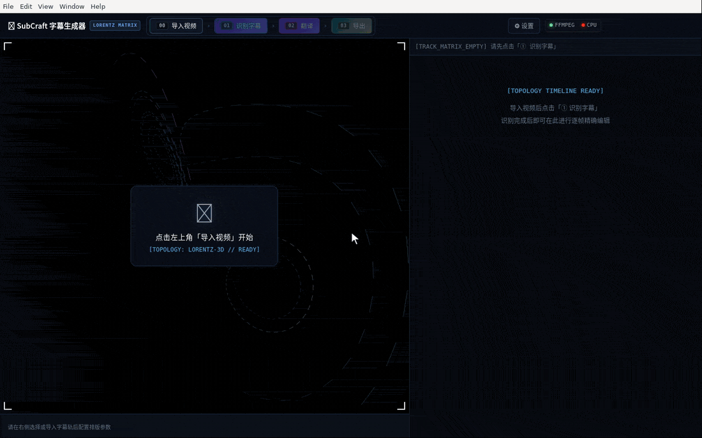

<div align="center">

# SubCraft

视频语音识别 + AI 翻译 + 双语字幕，一站做完并导出成片。

[](https://github.com/gengsha/subcraft/actions/workflows/ci.yml)
[](https://github.com/gengsha/subcraft/releases)
[](LICENSE)



[中文](#中文) · [English](#english)

</div>

## 中文

### 功能

- **识别**：本地 faster-whisper（可用 NVIDIA GPU）或 OpenAI Whisper API，自动断成适合上屏的短句
- **翻译**：OpenAI 兼容接口（DeepSeek、Kimi、通义、GLM、Claude 等）或 DeepL，支持术语表
- **双语**：原文 / 译文同屏，主副行可切换，字幕可在画面上直接拖动定位
- **时间轴**：贴齐镜头切点、拆分、合并、平移，自动检查重叠与阅读速度
- **导出**：SRT / ASS、MKV 软字幕（不重编码）、MP4 硬字幕
- **CLI 与 MCP**：全部功能可在终端批量运行，或交给 Claude、Cursor 等 AI 客户端调用

### 下载

到 [Releases](../../releases) 下载：

| 文件 | 说明 |
| --- | --- |
| `SubCraft-x.x.x-win-x64.zip` / `-portable.exe` | Windows 桌面版，解压即用，已内置后端与 ffmpeg |
| `SubCraft-x.x.x-x64-linux.tar.gz` | Linux 桌面版，需 `ffmpeg`、`python3`，并执行 `pip install -r resources/backend/requirements.txt` |
| `SubCraft-CLI-x.x.x-win-x64.zip` / `-linux-x64.tar.xz` | 纯命令行版（CLI + MCP），不含桌面界面，体积小 |

翻译需在「设置」里填 API Key，配置只存本机（`%LOCALAPPDATA%\SubCraft\config.json`）。

### 命令行

```bash
subcraft status                                   # 环境自检
subcraft gen video.mp4 -t zh --video hard         # 识别 + 翻译 + 烧录
subcraft batch ./课程 -r -t zh --video hard -o out  # 整个文件夹批量，可断点续跑
subcraft --help                                   # 全部命令：transcribe / translate / retime / export / preview ...
```

- 源码运行时把 `subcraft` 换成 `python backend/cli.py`
- 纯命令行版旁新建 `data` 文件夹即进入便携模式：配置和模型都存在里面，删掉文件夹就清理干净
- 纯命令行版只用 CPU 识别；Windows 首次使用会自动下载 ffmpeg，Linux 请 `sudo apt install ffmpeg`

### MCP（AI 客户端接入）

在 AI 客户端的 MCP 配置中加入：

```json
{ "mcpServers": { "subcraft": { "command": "D:/tools/subcraft/subcraft.exe", "args": ["mcp"] } } }
```

源码运行则用 `"command": "python", "args": ["<仓库路径>/backend/mcp_server.py"]`（需 `pip install -r backend/requirements-mcp.txt`）。共 28 个工具，覆盖识别、翻译、校对、时间轴、样式、导出和批量处理；没配翻译 API 时，AI 可以自己翻译后用 `subcraft_add_translation` 写回。`python backend/mcp_server.py --list-tools` 查看全部工具。

### 从源码运行

需要 Python 3.13+、Node.js 20+。

```bash
git clone https://github.com/gengsha/subcraft.git && cd subcraft
python -m venv .venv && .venv/Scripts/python -m pip install -r backend/requirements.txt
cd app && npm install && npm run dev
```

打包：`python backend/build_exe.py --no-cuda` 后 `cd app && npm run pack`；纯命令行版用 `python backend/build_cli.py`。测试：`python -m pytest`。

### 常见问题

- **MKV 软字幕没样式**：系统自带播放器支持有限，请用 VLC、PotPlayer 或 mpv，或导出硬字幕。
- **字幕显示方块**：所选字体缺少该语言字形，换成微软雅黑、思源黑体等。

MIT License

---

## English

Speech recognition, AI translation and bilingual subtitles in one tool, with export to finished video.

- **Transcribe** locally with faster-whisper (NVIDIA GPU optional) or the OpenAI Whisper API
- **Translate** via any OpenAI-compatible API (DeepSeek, Kimi, Qwen, GLM, Claude, …) or DeepL, with a glossary
- **Bilingual** layout with switchable primary line and drag-to-position on the video
- **Timeline** tools: snap to shot cuts, split, merge, shift, overlap and reading-speed checks
- **Export** SRT / ASS, soft-subtitle MKV (no re-encode) or hard-subtitle MP4
- **CLI and MCP**: run everything from a terminal in batch, or let Claude, Cursor and other AI clients drive it

**Download** from [Releases](../../releases): `SubCraft-x.x.x-win-x64.zip` (Windows desktop, ready to run), `SubCraft-x.x.x-x64-linux.tar.gz` (Linux desktop, needs `ffmpeg`, `python3` and `pip install -r resources/backend/requirements.txt`), or `SubCraft-CLI-*` (command line + MCP only, much smaller).

```bash
subcraft gen video.mp4 -t zh --video hard     # transcribe + translate + burn in
subcraft batch ./course -r -t zh -o out       # whole folder, resumable
subcraft mcp                                  # MCP server over stdio
```

MCP client config: `{ "mcpServers": { "subcraft": { "command": "D:/tools/subcraft/subcraft.exe", "args": ["mcp"] } } }`. From source, use `python backend/cli.py` and `python backend/mcp_server.py` instead. Create a `data` folder next to the CLI executable to keep config and models portable.

MIT License
